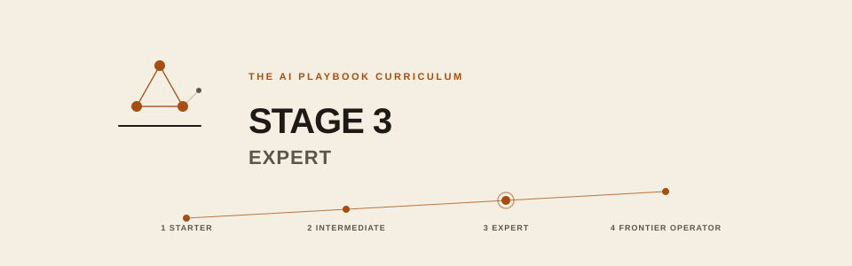

# Stage 3 Expert

**You are:** a builder.
**You will become:** a practitioner: shipping AI to real users with SLOs, handling incidents, drift, adversarial inputs, and cost at scale; then leading an AI team, doing custom model training, applied alignment, safety engineering, red-teaming. Comfortable with training-stack internals.
**The Curriculum's pace:** 10 to 18 months.

## Prerequisites

- Stage 2 exit criteria met
- Have shipped software to real users before (not necessarily AI)
- Comfortable with observability tools (metrics, traces, logs)
- Access to a production environment or willingness to build one
- Later in the stage: access to compute for training runs (cloud GPUs at minimum) and willingness to read papers

## Exit criteria

- You've shipped an AI product or feature to real users with SLOs met
- You've orchestrated a multi-agent workflow in production
- You've handled a real drift or incident (or run a realistic dry-run)
- You've done a model bake-off with a data-driven decision
- You've hardened one workflow against adversarial input
- You've fine-tuned a model with measurable impact
- You've led a red-team exercise
- You understand training-stack internals (attention, MoE, quantization, inference optimization)
- You can teach any Stages 1 to 3 concept clearly
- You can lead an AI team or an AI initiative
- For companies: full observability, incident response tested, cross-department scaling underway; applied research team stood up, safety program mature, cross-industry benchmarking

## Tracks

- **`individual/`**: 26 modules, 01 to 14 for production systems design, 15 to 26 for the practitioner
- **`company/`**: 18 modules, 01 to 10 for AI operations at organizational scale, 11 to 18 for mature AI organizations
- **`shared/`**: production checklist and templates; training, safety, and card templates
- **`eli10/`**: plain-language companions

## How to work Stage 3

Stage 3 is about shipping, then leading. Every module ends with "did you ship the thing?" Not "did you read about it."

1. Pick one Stage 2 project and take it to production (`01`, `06`)
2. Add observability and SLOs before customers touch it
3. Run a bake-off before you commit to a model (`08`)
4. Red-team it (`05`)
5. Write the incident playbook before you need it (`04`)
6. Deepen training-stack understanding (`16`): you cannot lead what you do not understand
7. Do a real fine-tuning project (`17`)
8. Build safety engineering discipline (`19`, `20`)
9. Master evaluation (`21`)
10. Teach the material (`25`): teaching forces mastery
11. Everything else is depth on the specialty you are pursuing

If you finish this stage, you can lead an AI product, platform, team, or initiative.

Formerly Level 3 Advanced and Level 4 Professional.
