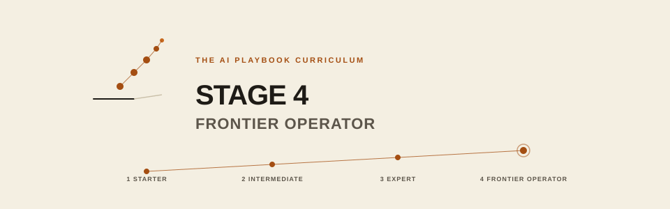

# Stage 4 — Frontier

**You are:** a practitioner.
**You will become:** a contributor to the field — original research, novel systems, category-defining products, open-weight training, foundation infra, or mechanistic interpretability.
**Typical time:** ongoing, indefinite.

## Prerequisites

- Stage 3 exit criteria met
- A point of view on where the field is going
- Access to a research community, employer, or funding path
- Comfort with uncertainty and long time horizons

## Exit criteria

Stage 4 doesn't have exit criteria in the usual sense. You're contributing to the field. The question is not "did I finish" but "did I move the state of the art forward, even a little."

- You've contributed original work: a paper, a novel system, a widely-used tool, or open-weight training
- You engage with the research community
- You have a point of view on where the field is going and act on it
- For companies: category-defining product, open-source contributions, industry-recognized capability

## Tracks

- **`individual/`** — 10 modules toward original contribution
- **`company/`** — 6 modules for frontier lab operations
- **`shared/`** — research templates
- **`eli10/`** — plain-language companions

## How to work Stage 4

Stage 4 is aspirational and non-linear. The map is a compass, not a checklist.

1. Read papers seriously (`01`) and reproduce results
2. Pick one or two areas where you'll go deep (`02`, `03`, or `04`)
3. Publish or ship something original (`06`, `07`)
4. Engage the community — reading, commenting, contributing
5. Build your own agenda over years, not months

If you engage seriously with this level, you become someone the field takes seriously back.
