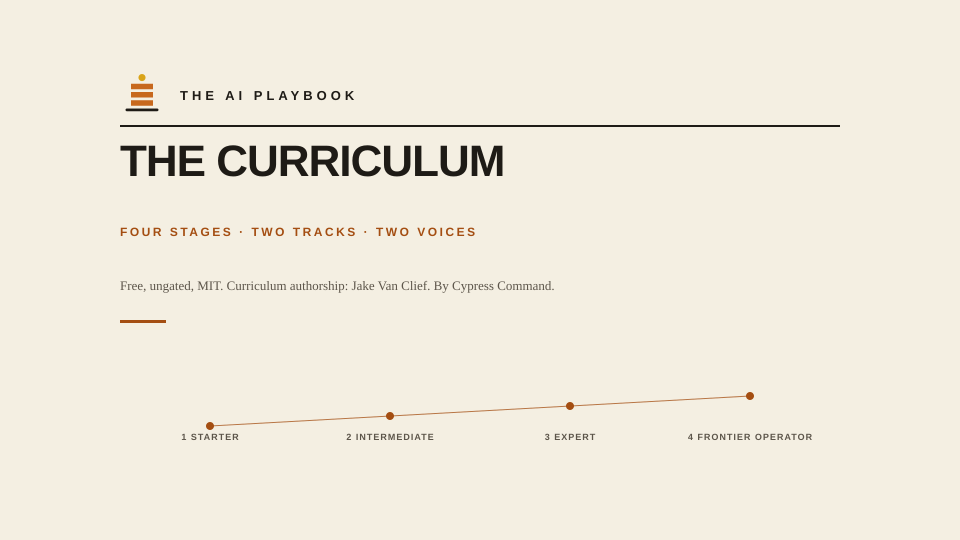

# The AI Playbook Curriculum

> **Part of [The AI Playbook](https://playbook.adamabdalla.com)** by Cypress Command. Free. Ungated. MIT. Curriculum authorship: Jake Van Clief.

The Playbook builds your system. The Curriculum builds you. Same four stages, same numbers, going deeper where you want to build the tooling rather than operate it.

**How this relates to the Playbook site:** the [site](https://playbook.adamabdalla.com) is what you build for a business, ten sections in four stages. This Curriculum is the same four stages for a person or a team who wants to build AI systems themselves. Full mapping: [PLAYBOOK-AND-CURRICULUM.md](PLAYBOOK-AND-CURRICULUM.md).

**Two tracks at every stage:** individual and company.
**Two voices at every stage:** the standard docs and an ELI10 companion.

> **Start with the letter:** [`shared/cover-letter/short-wake-up-letter.md`](shared/cover-letter/short-wake-up-letter.md), 5 minutes.
> Or the full case: [`shared/cover-letter/field-guide-manifesto.md`](shared/cover-letter/field-guide-manifesto.md), 30 minutes.

## The four stages

| Stage | You are... | You can... | The Curriculum's pace |
|---|---|---|---|
| **1 Starter** | New to AI | Use every top AI product well. Know the jargon. Have your own prompts and rituals. | 30 days |
| **2 Intermediate** | Comfortable with AI | Build your own agents, RAG systems, and MCP servers. Own your evals. Control cost. | 60 to 90 days |
| **3 Expert** | An AI builder | Ship AI features to real users. Orchestrate multi-agent systems. Handle drift, incidents, and adversarial inputs at scale. Lead an AI team. Custom training. Applied alignment. Safety engineering. Red-teaming. | 10 to 18 months |
| **4 Frontier Operator** | An AI practitioner | Build novel systems, publish research, contribute to open weights or foundation infra. | Ongoing |

The pace column is the Curriculum's own estimate for the depth track. It is not the Playbook's stage gate; the Playbook's stages are measured in weeks of building your system, and the two run in parallel.

See `STAGE-MAP.md` for the exit criteria at every stage.

## Where to start

- **Start reading:** `shared/cover-letter/short-wake-up-letter.md` (5 min)
- **Get convinced:** `shared/cover-letter/field-guide-manifesto.md` (30 min)
- **Start doing:** `1-starter/00-start-here/30-day-starter-sequence.md`
- **Set up your tools:** [`shared/starter-packs/`](shared/starter-packs), ready-to-paste custom instructions for Claude, ChatGPT, Perplexity, Claude Code, Cursor, Grok, Gemini, and the Anthropic API

## Not sure this is the right program for you?

Read [PLAYBOOK-AND-CURRICULUM.md](PLAYBOOK-AND-CURRICULUM.md). The Curriculum assumes your files, identity, and knowledge are already in a shape AI can use. If they are not yet, start with [The AI Playbook](https://playbook.adamabdalla.com), Stage 1. Both are free; both are open. Neither gates its content.

## The ELI10 layer

Every technical section in this program has a matching plain-language companion in the `eli10/` folder at that stage. Think of it as the same information explained to a curious 10-year-old: no jargon, real analogies, why-it-matters framing.

If a section feels dense, jump to its ELI10 twin first, then come back.

## Program design principles

1. **Two tracks, every stage:** individual and company
2. **Two voices, every stage:** technical and ELI10
3. **Every doc is opinionated:** no placeholder shrug docs
4. **Every workflow has an eval:** measurable, not vibes
5. **Every autonomy step is earned:** HITL before full auto
6. **Governance in front of scale:** policy before pilots
7. **Continuous refresh:** the field moves; the kit moves with it

## Lineage

Formerly the Groundwork Curriculum (five levels, August 2026): Stage 3 Expert combines what were Level 3 Advanced and Level 4 Professional, and the module numbering inside Stage 3 runs straight through. The site's `/lineage/` page records the full history.

## Ownership

You. Fork it. Extend it. Prune it. Ship your own kits from it.

## License

MIT (see `LICENSE`). Use it, remix it, teach with it.
